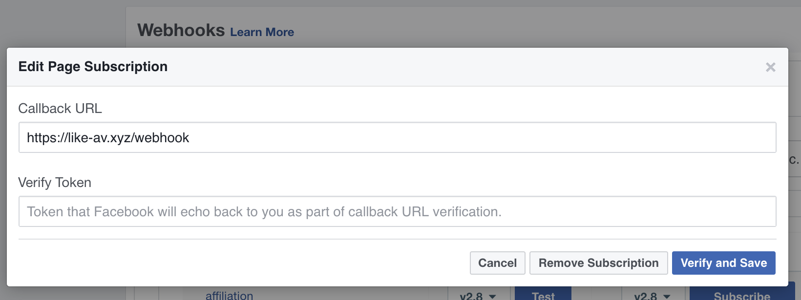
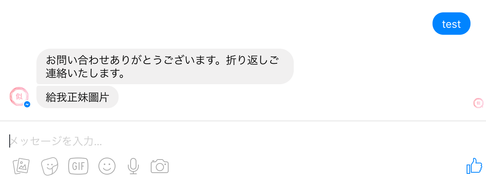
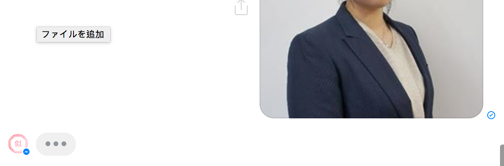
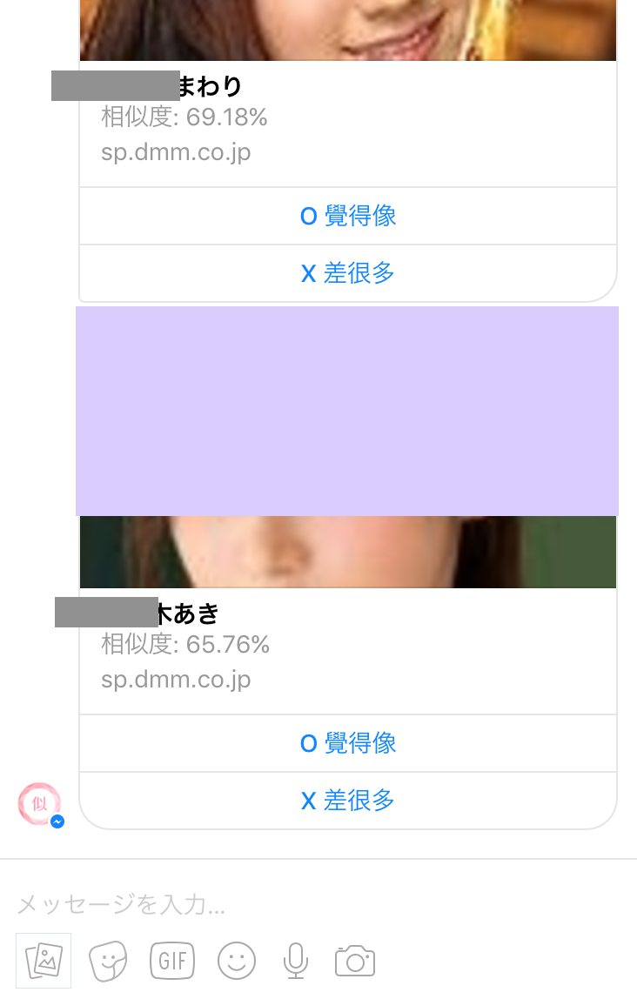
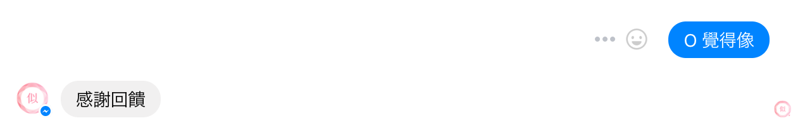
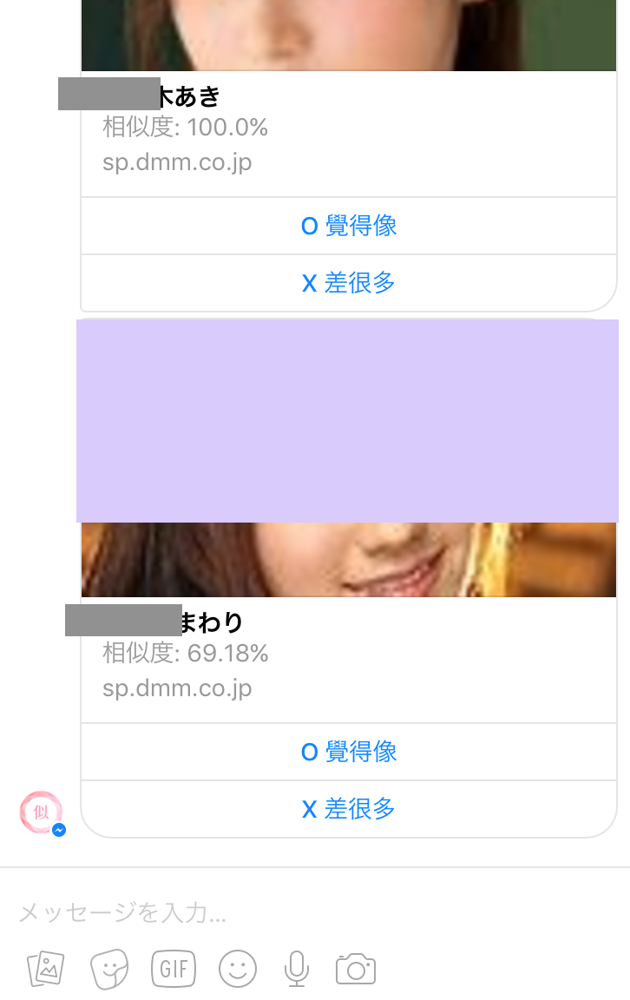
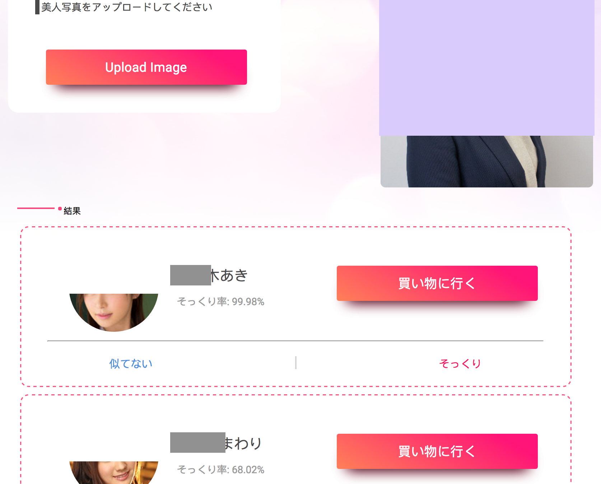
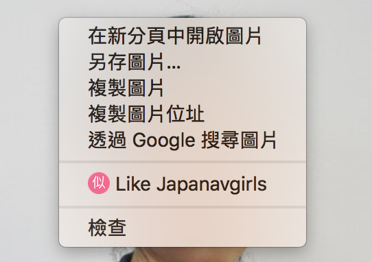
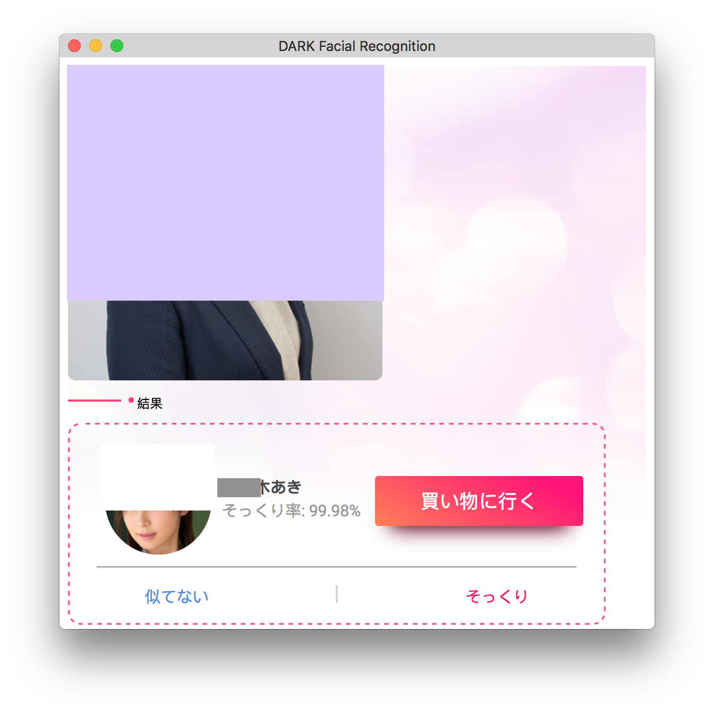

- Facebook Messenger Bot (private for tester account): https://m.me/like-japanavgirls
- Web App: https://like-av.xyz/
- Chrome Extension: https://chrome.google.com/webstore/detail/like-japanavgirls/ehhdbpobmjcndjibgblgnbgmhjmfmhae
- iOS App: https://itunes.apple.com/us/app/likegirl/id1262331185

## Structure


## Preparement
1. register domain name with [お名前.com](http://www.onamae.com/)
1. Let's Encrypt certificate authority with NGINX
1. run docker mongodb service: `docker run -p 27017:27017 -v <mount_path>:/data/db -d mongo --auth`
1. create facebook page for messenger

## Facebook Messenger Bot with Python
### requisites
* requests
* beautifulsoup4
* boto3
* tornado
* pymongo
* jproperties

### face data (daily cron job)
fetch monthly, daily, and work face data
```bash
$ python bot/scheduler.py
```

two main class to process data
- AWS([bot/aws.py](https://github.com/Jim-Lin/like-japanavgirls/blob/master/bot/aws.py)): aws rekognition api
    - insert_index_face: insert face data with index of ExternalImageId
    - search_faces: search faces' similarity above 20%
- DAO([bot/dao.py](https://github.com/Jim-Lin/like-japanavgirls/blob/master/bot/dao.py)): mongodb find and update operation
    - find_one_actress_by_id
    - update_one_info_by_actress
    - find_one_works_by_id
    - update_one_works_by_id
    - update_one_feedback_by_id

#### mongodb sample document
```json
{
    "_id": ObjectId("5877d3f47b991c5356a45xxx"),
    "id": "103xxx",
    "img": "http://pics.dmm.co.jp/mono/actjpgs/xxx.jpg",
    "name": "XXX",
    "works": [
        "2wwkxxx",
        ...
    ],
    "count": 2,
    "like": [
        "2017-03-13/17204117_xxx.jpg"
    ],
    "unlike": [
        "2017-03-13/5_xxx.jpg"
    ]
}
```

### webhook
launch webhook handler server for facebook app
```bash
$ python bot/server.py
```

go to your app https://developers.facebook.com/apps/xxx/webhooks/ setting and input your webhook url



---

modify your Verify Token and Page Access Token in [bot/handler.py](https://github.com/Jim-Lin/like-japanavgirls/blob/master/bot/handler.py)
- Verify Token: the same as above what you set
- Page Access Token: page which you created for messenger permissions

there are two type events in bot/handler.py post function
- message: **text** or **attachments** data
- postback: user's feedback **payload** data to improve accuracy

### facebook bot sample operation
#### WebHookHandler [bot/handler.py](https://github.com/Jim-Lin/like-japanavgirls/blob/master/bot/handler.py)
- message event(text): response text in handler



---

- message event(attachment): load image data and search faces in handler and then responses if the image has matches face



---


---

- postback event(payload): if you think the second one is more similar than first one, press **O** button and then responses the postback event with payload data in handler. upload the same image again and then you will get the new similarity order



---


---

## Back-end Api Server with Rust
Rewritten from Go to Rust. The HTTP API (routes, request and response JSON) is unchanged, so the web app, Chrome extension and iOS app work as before. See [api/MIGRATION.md](https://github.com/Jim-Lin/like-japanavgirls/blob/master/api/MIGRATION.md) for the full Go → Rust migration notes.

### requisites
* [tokio](https://crates.io/crates/tokio) + [axum](https://crates.io/crates/axum): async HTTP server
* [aws-sdk-rekognition](https://crates.io/crates/aws-sdk-rekognition) + [aws-config](https://crates.io/crates/aws-config): AWS Rekognition
* [mongodb](https://crates.io/crates/mongodb): official MongoDB driver (**requires MongoDB 4.4+**)
* [serde](https://crates.io/crates/serde) / [serde_json](https://crates.io/crates/serde_json): JSON
* [chrono](https://crates.io/crates/chrono), [uuid](https://crates.io/crates/uuid), [anyhow](https://crates.io/crates/anyhow), [tracing](https://crates.io/crates/tracing)

### run
```bash
$ cd api
# mongodb.properties in the working directory:
#   username=...
#   password=...
# AWS credentials via env vars, ~/.aws or an IAM role
$ cargo run --release        # listens on 0.0.0.0:9090
$ cargo test
```

build a static Linux x86_64 binary (musl, no glibc dependency) with Docker, output to `api/target/linux-amd64/api`:
```bash
$ ./api/build-linux-amd64.sh
```

logs: `api` at info, other crates at warn by default. Override with `RUST_LOG`, e.g. `RUST_LOG=api=debug`.

### upload handler([api/src/main.rs](https://github.com/Jim-Lin/like-japanavgirls/blob/master/api/src/main.rs))
1. call aws rekognition SearchFacesByImage api (collection `rankingcollection_v7`) in [search_faces_by_image](https://github.com/Jim-Lin/like-japanavgirls/blob/master/api/src/aws.rs) function to search faces' similarity above 20%; the actress id is the ExternalImageId before the first `_`
1. select top 2 similarity and find actress data by id in [find_one_actress](https://github.com/Jim-Lin/like-japanavgirls/blob/master/api/src/db.rs)
1. create [Payload](https://github.com/Jim-Lin/like-japanavgirls/blob/master/api/src/main.rs) response json format

### feedback handler([api/src/main.rs](https://github.com/Jim-Lin/like-japanavgirls/blob/master/api/src/main.rs))
1. validate input: "ox" must be "like" or "unlike", and "file" must be a path returned by upload (`YYYY-MM-DD/<8 hex>_<name>`)
1. update "like or unlike" of image with id in [upsert_one_feedback](https://github.com/Jim-Lin/like-japanavgirls/blob/master/api/src/db.rs)

any error (including invalid input) returns HTTP 200 with the empty payload `{"Count":0,"File":"","Data":null}`, same as the Go version.

## Front-end with native JavaScript (no 3rd party library)
### upload([web/app.js](https://github.com/Jim-Lin/like-japanavgirls/blob/master/web/app.js))
- url: http://like-av.xyz/api/upload
- method: POST in XMLHttpRequest
- form-data: {upload: \<blob\>}

#### response sample json
```json
{
    "Count": 2,
    "Data" : [
        {
        	"Id": "102xxx",
        	"Img": "http://pics.dmm.co.jp/mono/actjpgs/xxx.jpg",
        	"Name": "xxx",
        	"Similarity": "99.98"
        },
        ...
    ],
    "File" : "2017-03-20/12274445_xxx.jpg"
}
```



---

### feedback([web/app.js](https://github.com/Jim-Lin/like-japanavgirls/blob/master/web/app.js))
- url: http://like-av.xyz/api/feedback
- method: POST in XMLHttpRequest
- json-data: {id: \<id\>, ox: \<"like" | "unlike"\>, file: \<filename\>}

## Chrome-Extension
### context menu
set up context menu tree at install time and only for image context in [chrome-extension/background.js](https://github.com/Jim-Lin/like-japanavgirls/blob/master/chrome-extension/background.js)



---
popup window, preview, and call upload api in [chrome-extension/info.js](https://github.com/Jim-Lin/like-japanavgirls/blob/master/chrome-extension/info.js) and then get json data to show result



---
